# 🚗 Application Android — Location de Voitures v2.0

Application Android complète de gestion d'une agence de location de voitures : véhicules, clients, réservations, paiements et notifications, avec une interface dédiée aux rôles **Admin**, **Employé** et **Client**.

[](./LICENSE)

| | |
| :--- | :--- |
| **🛠️ Technologies** | Java · Android SDK 34 · SQLite · Material Design 3 |
| **🎓 Projet** | 3IACN — Oussama El Hilali |
| **📱 Version** | 2.0 |
| **📄 Licence** | [MIT](./LICENSE) |

## 📸 Aperçu de l'application

| Connexion | Dashboard Admin |
| :---: | :---: |
| 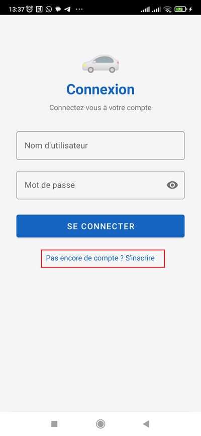 | 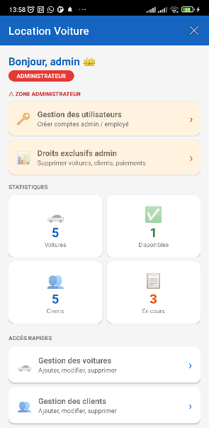 |

| Gestion des voitures | Dashboard Client |
| :---: | :---: |
| 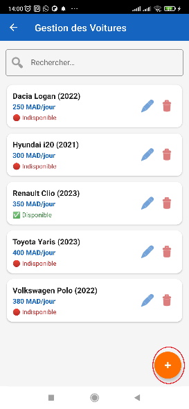 | 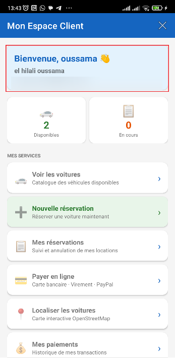 |

| Paiement en ligne | Réservation confirmée |
| :---: | :---: |
| 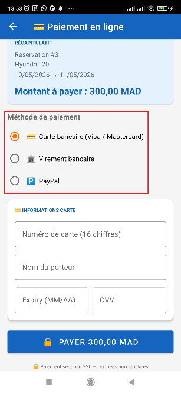 | 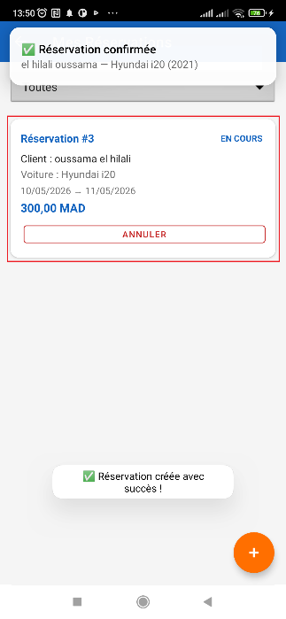 |

| Notifications | Historique des paiements |
| :---: | :---: |
| 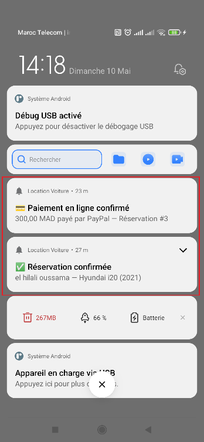 | 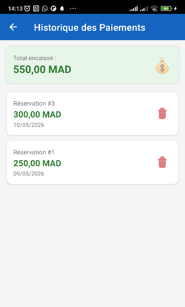 |

## 🚀 Installation

### Prérequis
- **Android Studio** avec le SDK Android 34 et un JDK 17
- Un appareil ou un émulateur sous Android 8.0+ (API 26)

### Lancer le projet
```bash
git clone https://github.com/Oussamaelhilali2025/CarRentalApp.git
cd CarRentalApp

# Windows
gradlew.bat assembleDebug

# macOS / Linux
./gradlew assembleDebug
```

L'APK généré se trouve dans `app/build/outputs/apk/debug/app-debug.apk` et peut être installé avec :

```bash
adb install app/build/outputs/apk/debug/app-debug.apk
```

## Nouvelles fonctionnalités (v2.0)

### 💳 Paiement en ligne (PaiementEnLigneActivity)
- **Carte bancaire** (Visa / Mastercard) avec validation numéro, CVV, date d'expiration
- **Virement bancaire** avec IBAN
- **PayPal** (simulation)
- Simulation d'un traitement réseau réaliste (2,5 secondes)
- Enregistrement automatique en base SQLite si succès
- **Test de refus** : utiliser un numéro se terminant par `0000`

### 📍 Géolocalisation des voitures (GeolocationActivity)
- Carte interactive **OpenStreetMap** (Leaflet.js) via WebView — pas de clé API
- Marqueurs 🚗 (disponibles) et 🔴 (indisponibles) avec popup détaillé
- Localisation GPS de l'utilisateur (📍)
- Fonctionne hors ligne une fois la page chargée
- En production : remplacer les coordonnées simulées par les vraies positions GPS

### 🔔 Notifications locales (NotificationService)
- **Réservation créée** → notification avec détails client + voiture
- **Paiement enregistré** → notification avec montant + reste à payer
- **Paiement en ligne** → notification de confirmation
- Canaux séparés : Réservations, Paiements, Rappels
- Compatible Android 8.0+ (Oreo) avec gestion des canaux

### 📱 Application client séparée (ClientDashboardActivity)
- Interface dédiée aux **clients** (rôle = "client")
- Accès direct à : voitures disponibles, nouvelle réservation, mes réservations, paiement en ligne, géolocalisation
- Les admin/employés ont leur propre dashboard (MainActivity)
- Routage automatique selon le rôle à la connexion

## Comptes de test
| Utilisateur | Mot de passe | Rôle |
|-------------|-------------|------|
| admin | admin123 | Admin (dashboard complet) |
| employe1 | employe123 | Employé |
| S'inscrire | — | Client (dashboard client) |

## Architecture
```
activities/
├── SplashActivity          → Routage par rôle
├── LoginActivity           → Auth + demande permission notifications
├── RegisterActivity        → Inscription (rôle client par défaut)
├── MainActivity            → Dashboard Admin/Employé
├── ClientDashboardActivity → Dashboard Client (NOUVEAU)
├── VoitureListActivity / VoitureFormActivity
├── ClientListActivity / ClientFormActivity
├── ReservationListActivity / ReservationFormActivity / ReservationDetailActivity
├── PaiementListActivity / PaiementFormActivity
├── PaiementEnLigneActivity → Paiement en ligne (NOUVEAU)
└── GeolocationActivity     → Carte des voitures (NOUVEAU)

services/
└── NotificationService     → Notifications locales (NOUVEAU)
```

## Technologies utilisées
- **Java** + Android SDK 34
- **SQLite** (local, 100% hors ligne)
- **Material Design 3**
- **OpenStreetMap / Leaflet.js** (WebView) — pas de clé API
- **NotificationCompat** (androidx.core)

## Permissions AndroidManifest
- `INTERNET` — OpenStreetMap + simulation paiement
- `ACCESS_FINE_LOCATION` / `ACCESS_COARSE_LOCATION` — GPS utilisateur
- `POST_NOTIFICATIONS` — Notifications Android 13+

## 🏗️ Conception

### Modèle Conceptuel de Données (MCD)
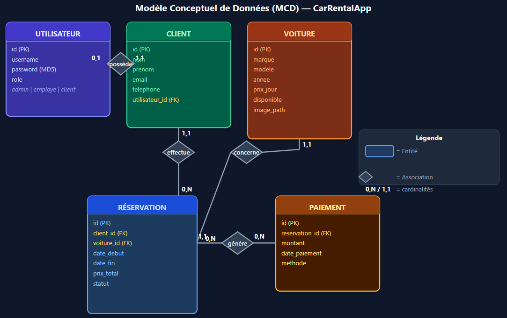

### Diagramme de classes
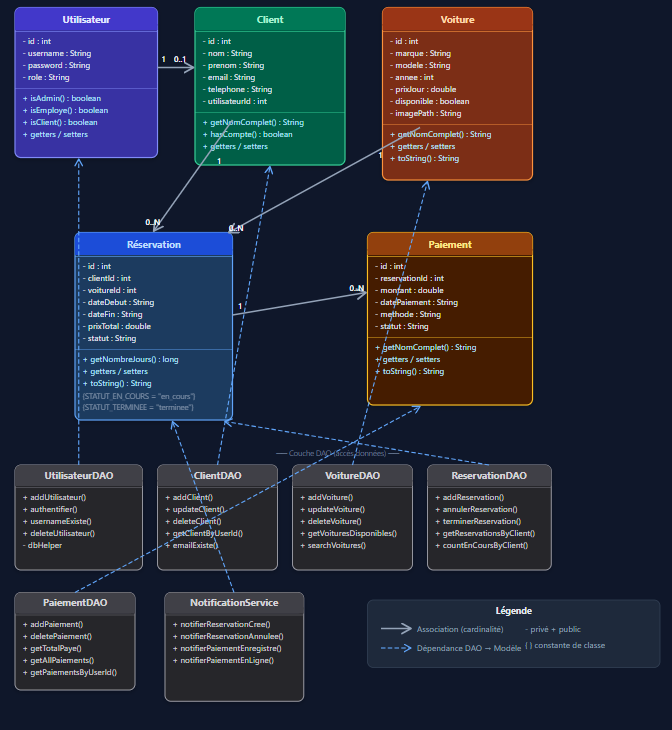

### Diagramme de cas d'utilisation
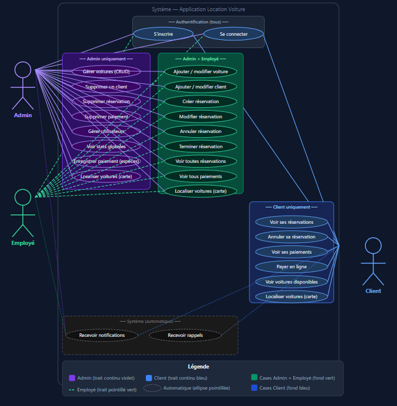

## 📄 Licence

Ce projet est distribué sous licence **MIT**. Voir le fichier [LICENSE](./LICENSE) pour plus de détails.

Copyright (c) 2026 Oussama El Hilali